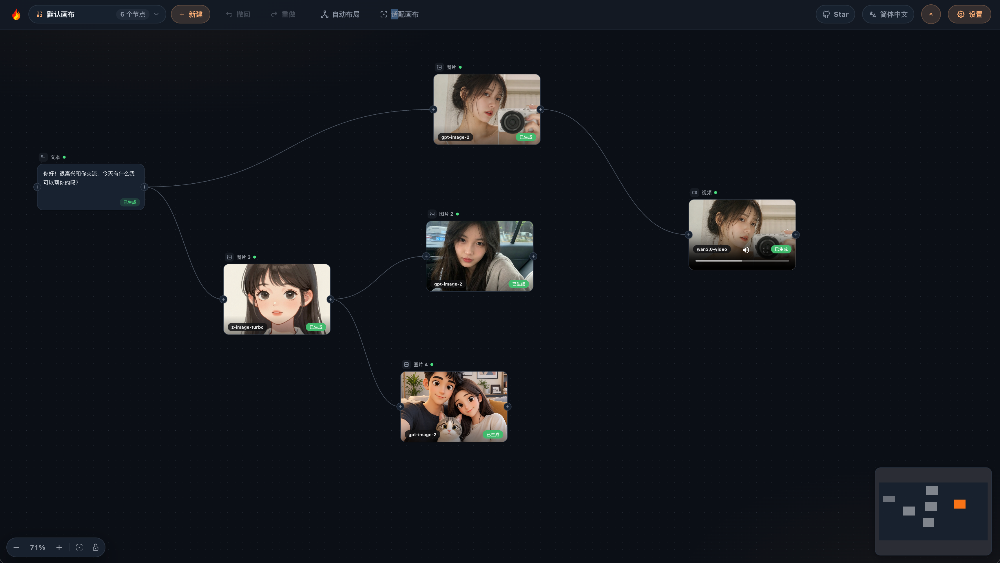
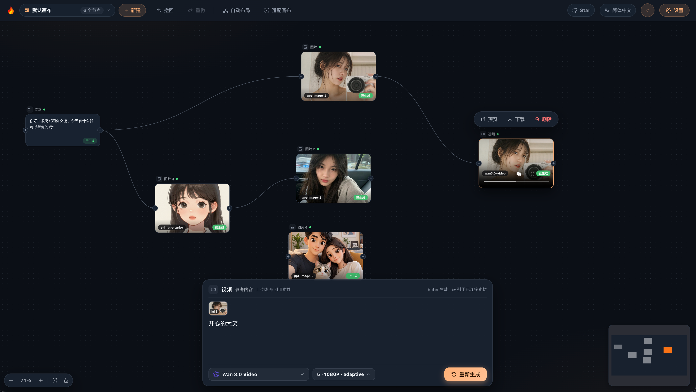
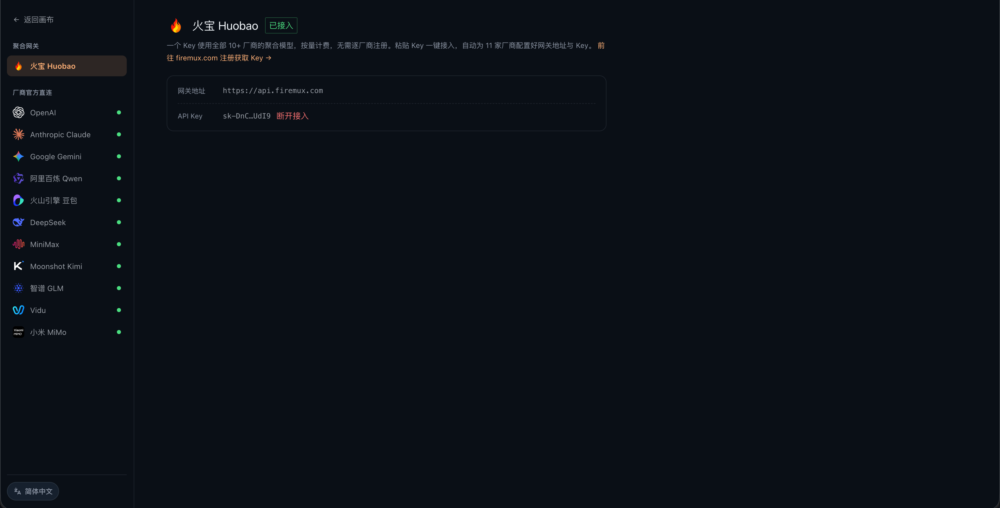
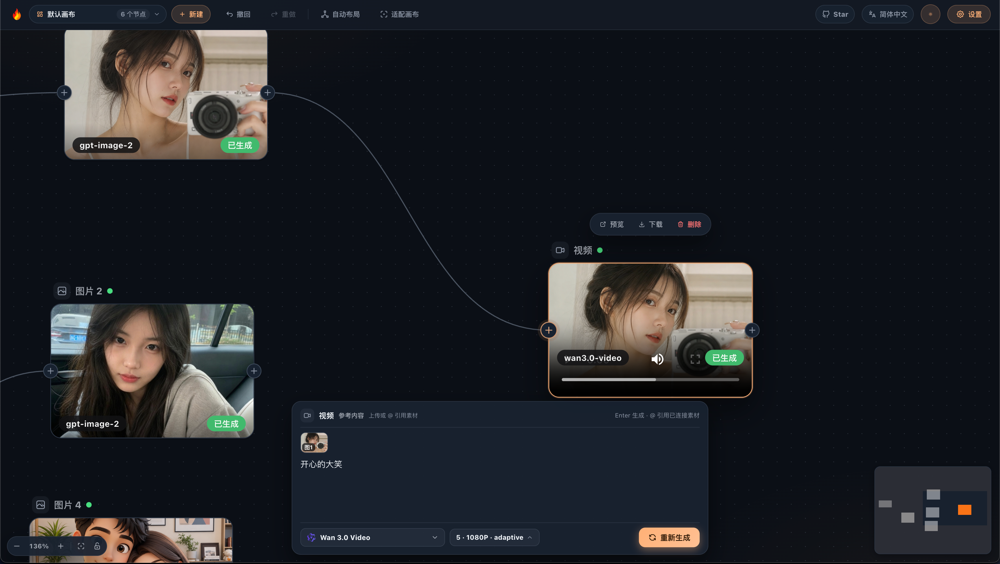
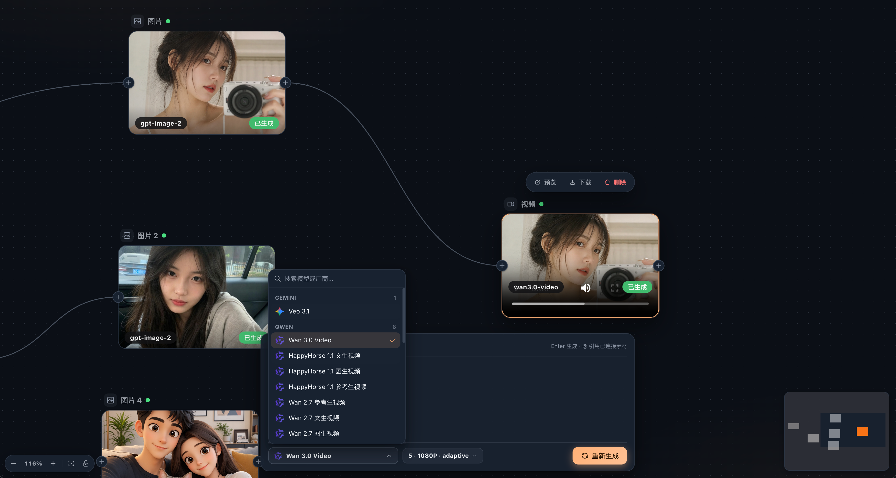

# 🎨 Huobao Canvas — AI 创作画布 / AI Creation Canvas

<div align="center">

**开源的节点式 AI 创作画布：无限画布串联 11 家厂商的文本 / 图像 / 视频生成模型**<br>
**An open-source, node-based AI creation canvas — chain text, image, and video models from 11 providers on an infinite canvas**

[](https://vuejs.org)
[](https://vitejs.dev)
[](https://hub.docker.com/r/huobao/huobao-canvas)
[](https://creativecommons.org/licenses/by-nc-sa/4.0/)

**中英双语 / Bilingual** | [简体中文](README.zh-CN.md) | [English](README.en.md) | [日本語](README.ja.md) | [한국어](README.ko.md)

<p>
  <a href="https://api.firemux.cn">
    
  </a>
</p>

**文本 · 图片 · 视频全部 AI 能力，一个 Key 即可开通**<br>
**Text, image, and video AI capabilities — one key unlocks everything**

打开「设置 → 火宝快捷配置」粘贴 Key，一键写入 11 家厂商配置，开箱即用<br>
Paste the key in "Settings → Huobao Quick Setup" to configure all 11 providers in one click

<p>
  <a href="https://github.com/chatfire-AI/huobao-canvas/releases/latest">
    
  </a>
</p>

<p><a href="https://installer.chatfire.site/huobao-canvas/v1.0.3/HuobaoCanvas-1.0.3-arm64.dmg">国内镜像 / China Mirror (macOS arm64)</a> · <a href="https://installer.chatfire.site/huobao-canvas/v1.0.3/HuobaoCanvas.Setup.1.0.3.exe">国内镜像 / China Mirror (Windows)</a> · <a href="https://marketing.firemux.cn/huobao-canvas/">在线体验 / Live Demo</a></p>
<p>
  <a href="https://firemux.cn">
    
  </a>
</p>

</div>

---

## 📖 项目简介 / Overview

Huobao Canvas 是一个开源的节点式 AI 创作画布。在无限画布上放置文本 / 图像 / 视频节点，连线即把上游产出作为下游输入——文生图、图生视频、参考生视频自由串联，各家模型即插即用。<br>
Huobao Canvas is an open-source, node-based AI creation canvas. Place text / image / video nodes on an infinite canvas and wire them together — upstream outputs flow into downstream inputs. Text-to-image, image-to-video, reference-to-video: mix and match models freely.

### 🎯 核心价值 / Why Huobao Canvas

- **🎨 画布即工作流**：四种节点 + 类型化连线规则，所见即所得的创作流水线<br>
  **🎨 Canvas as workflow**: four node types + typed connection rules — your creation pipeline, visualized
- **🧩 官方格式内置**：11 家厂商的官方出入参适配，填 Key 即用，无中间格式损耗<br>
  **🧩 Official formats built-in**: native request/response adapters for 11 providers — just add your key
- **🔑 BYOK 自带钥匙**：Key 存浏览器本地，自部署时自动镜像到服务端，换浏览器无缝接管<br>
  **🔑 BYOK**: keys stay in your browser; on self-hosted deployments they mirror to the server automatically
- **📦 三形态部署**：Docker 单镜像 / Electron 桌面版 / 纯 Web 开发模式，同一份代码<br>
  **📦 Three deployment shapes**: single Docker image / Electron desktop / plain web dev — same codebase

### 🛠️ 技术架构 / Architecture

```
apps/web/     — Vue 3.5 + Vite 5 + Vue Flow + Naive UI + Pinia + vue-i18n + Tailwind
apps/server/  — 零 npm 依赖 Node 服务端（node:sqlite + 内置 fetch），画布存储 + 运行队列 / Zero-dependency Node server (node:sqlite + built-in fetch): canvas storage + run queue
apps/desktop/ — Electron 壳（utilityProcess 内嵌 server，esbuild 打包 + electron-builder 出 dmg/exe） / Electron shell (utilityProcess embeds the server; esbuild + electron-builder → dmg/exe)
docker/       — 单镜像一体化部署（前端产物 + 服务端 bundle，amd64/arm64 多架构） / All-in-one single image (frontend build + server bundle, amd64/arm64)
```

---

## ✨ 功能特性 / Features

### 🎨 无限画布 / Infinite Canvas

- ✅ 文本 / 图像 / 视频 / 分组四种节点，拖拽连线构建创作流水线<br>
  ✅ Text / image / video / group nodes — wire up your creation pipeline visually
- ✅ 上游产出自动注入下游：文生图 → 图生视频 → 参考生视频<br>
  ✅ Upstream outputs auto-inject downstream: text-to-image → image-to-video → reference-to-video
- ✅ 类型化连线规则 + 连线拖出落点菜单，防止无效连接<br>
  ✅ Typed connection rules + drop-point menu on drag-out prevents invalid wiring
- ✅ 撤销 / 重做、自动布局、框选多选、画布缩放，完整编辑体验<br>
  ✅ Undo / redo, auto-layout, box selection, zoom — a complete editing experience

### 🧩 11 家厂商官方适配 / 11 Providers, Official Adapters

OpenAI、Anthropic、Gemini、Qwen、火山引擎、DeepSeek、MiniMax、Moonshot、智谱、Vidu、小米 MiMo<br>
OpenAI, Anthropic, Gemini, Qwen, Volcengine, DeepSeek, MiniMax, Moonshot, Zhipu, Vidu, Xiaomi MiMo

| 类型<br>Type | 代表模型<br>Notable Models |
|---|---|
| **对话**<br>**Chat** | GPT、Claude、Gemini、Qwen3、DeepSeek、Kimi、GLM、MiMo<br>GPT, Claude, Gemini, Qwen3, DeepSeek, Kimi, GLM, MiMo |
| **图像**<br>**Image** | GPT Image 1.5/2、Gemini 图像、豆包 Seedream、万相<br>GPT Image 1.5/2, Gemini Image, Doubao Seedream, Wan |
| **视频**<br>**Video** | 万相 2.7/3.0（文生/图生/参考生）、Seedance、Vidu、MiniMax<br>Wan 2.7/3.0 (t2v/i2v/reference), Seedance, Vidu, MiniMax |

- ✅ 每家厂商的官方鉴权方式（Bearer / x-api-key / x-goog-api-key / Token）与出入参格式<br>
  ✅ Per-provider official auth (Bearer / x-api-key / x-goog-api-key / Token) and payload formats
- ✅ 双端点模型（如 GPT Image 文生图/图片编辑）画布内一键切换生成模式，连线参考自动识别<br>
  ✅ Dual-endpoint models (e.g. GPT Image text-to-image / image-edit): switch generation mode in-canvas, connected references detected automatically
- ✅ 设置页按厂商配 Key、连通测试、模型启停、自定义模型<br>
  ✅ Settings page: per-provider keys, connectivity tests, model toggles, custom models

### 🖥️ 服务端运行队列 / Server-side Run Queue

- ✅ 模型调用经服务端执行，刷新 / 换浏览器任务不丢<br>
  ✅ Model calls execute on the server — refresh or switch browsers, tasks survive
- ✅ 异步视频任务服务端自动轮询（预算 2 小时），长视频放心挂机<br>
  ✅ Async video tasks polled server-side (2-hour budget) — let long renders run
- ✅ 画布数据存 SQLite，多浏览器打开同一部署即同一份数据<br>
  ✅ Canvas data in SQLite — every browser on the same deployment sees the same canvas

### 🌍 四语界面 / Four Languages

简体中文 / English / 日本語 / 한국어，界面内一键切换。<br>
简体中文 / English / 日本語 / 한국어 — switch right in the UI.

### 🔄 双目录模式 / Two Catalog Modes

- **官方直连（默认）**：按厂商官方格式直连，独立可用，无需任何网关<br>
  **Official direct (default)**: talk to providers in their native formats, works standalone
- **网关模式**：接入任意 OpenAI 兼容网关（如 Huobao），一个 Key 调用全部模型<br>
  **Gateway mode**: plug into any OpenAI-compatible gateway (e.g. Huobao) — one key for everything

---

## 🚀 快速开始 / Quick Start

### 📥 方式一：桌面版（推荐） / Option 1: Desktop App (Recommended)

[前往 Releases 下载](https://github.com/chatfire-AI/huobao-canvas/releases/latest)（海外）· **国内镜像直链**（腾讯云，免翻墙，同版本同文件）：<br>
[Download from Releases](https://github.com/chatfire-AI/huobao-canvas/releases/latest) (overseas) · **China mirror direct links** (Tencent Cloud, no proxy needed, same files):

**[macOS arm64 .dmg](https://installer.chatfire.site/huobao-canvas/v1.0.3/HuobaoCanvas-1.0.3-arm64.dmg)** · **[macOS Intel .dmg](https://installer.chatfire.site/huobao-canvas/v1.0.3/HuobaoCanvas-1.0.3.dmg)** · **[Windows .exe](https://installer.chatfire.site/huobao-canvas/v1.0.3/HuobaoCanvas.Setup.1.0.3.exe)**

| 平台<br>Platform | 文件<br>File |
|---|---|
| macOS Apple Silicon | `HuobaoCanvas-<版本>-arm64.dmg`<br>`HuobaoCanvas-<version>-arm64.dmg` |
| macOS Intel | `HuobaoCanvas-<版本>.dmg`<br>`HuobaoCanvas-<version>.dmg` |
| Windows x64 | `HuobaoCanvas.Setup.<版本>.exe`<br>`HuobaoCanvas.Setup.<version>.exe` |

> 国内用户建议用镜像直链下载；应用内更新器同样国内源（腾讯 COS）优先、GitHub 兜底。<br>
> Users in China should prefer the mirror; the in-app updater likewise tries the China source (Tencent COS) first, falling back to GitHub.

- 双击安装、开箱即用：内嵌服务端 + SQLite 存储，数据存用户目录，卸载不丢数据<br>
  Double-click install, works out of the box: embedded server + SQLite, data lives in the user directory — uninstalling keeps your data
- macOS 未签名包首次打开需右键 → 打开，或执行 `xattr -cr /Applications/HuobaoCanvas.app`<br>
  Unsigned macOS builds: right-click → Open on first launch, or run `xattr -cr /Applications/HuobaoCanvas.app`
- Windows 未签名包 SmartScreen 会提示「更多信息 → 仍要运行」<br>
  Unsigned Windows builds: SmartScreen → "More info → Run anyway"

### 🐳 方式二：Docker / Option 2: Docker

```bash
docker run -d -p 8080:16812 -v canvas-data:/app/data huobao/huobao-canvas:latest
# 打开 http://localhost:8080 / Open http://localhost:8080
```

镜像发布在 [Docker Hub](https://hub.docker.com/r/huobao/huobao-canvas)，多架构 `linux/amd64` + `linux/arm64`（Linux 服务器 / Windows / macOS 通用），可指定版本标签（如 `huobao/huobao-canvas:1.0.0`）锁定版本。或用 compose（附 Watchtower 每日自动更新）：<br>
Multi-arch image (`linux/amd64` + `linux/arm64`, works on Linux servers / Windows / macOS) on [Docker Hub](https://hub.docker.com/r/huobao/huobao-canvas) — pin a version with its tag (e.g. `huobao/huobao-canvas:1.0.0`). Or use compose (Watchtower auto-updates daily):

```bash
cp .env.example .env       # 按需修改 WATCHTOWER_TOKEN / edit WATCHTOWER_TOKEN as needed
docker compose up -d
```

### 💻 方式三：本地开发 / Option 3: Local Development

```bash
git clone https://github.com/chatfire-AI/huobao-canvas.git
cd huobao-canvas/apps/web
pnpm install && pnpm dev   # http://localhost:8022
```

> 本地开发如需画布持久化与服务端运行队列，另开终端 `pnpm -C apps/server dev`（Node ≥ 22.13）。<br>
> For canvas persistence and the server-side run queue during local dev, run `pnpm -C apps/server dev` in another terminal (Node ≥ 22.13).

### 🔑 首次使用：配置 API Key / First Run: Add an API Key

打开页面 → 右上角「设置」：<br>
Open the page → "Settings" (top right):

1. **火宝快捷配置**（推荐）：粘贴 FireMux API Key（[前往 api.firemux.cn 获取](https://api.firemux.cn)），一键写入 11 家厂商的 Key 与网关地址<br>
   **Huobao Quick Setup (recommended)**: paste a FireMux API Key ([get one at api.firemux.com](https://api.firemux.com)) — one click writes keys and gateway URLs for all 11 providers
2. **手动配置**：按厂商逐个填入官方 API Key，支持连通测试<br>
   **Manual setup**: enter each provider's official API key, with connectivity tests

Key 默认保存在浏览器 localStorage；自部署时自动镜像到服务端（换浏览器无缝接管）。<br>
Keys stay in browser localStorage by default; on self-hosted deployments they mirror to the server automatically (switch browsers seamlessly).

---

## 📖 图文教程 / Visual Walkthrough

从空画布到文生图、图生视频、参考编辑的完整创作流程，5 步走完。<br>
From an empty canvas to text-to-image, image-to-video, and reference-based editing — five steps.

### 第 1 步 · 搭建创作流水线 / Step 1 · Build Your Pipeline

左侧拖入文本 / 图像 / 视频节点，从节点边缘的 **+** 拉线连接——上游产出自动成为下游输入。文本 → 图片 → 图片编辑 → 视频，一张画布就是一条生产线。左上角可撤回 / 重做 / 自动布局，右下角小地图导航大图。<br>
Drag text / image / video nodes in from the left, then wire them from the **+** handle on a node's edge — upstream output becomes downstream input automatically. Text → image → image edit → video: one canvas, one production line. Undo / redo / auto-layout live top-left; the minimap bottom-right navigates large graphs.

<p align="center">
  
</p>

### 第 2 步 · 连线参考自动注入 / Step 2 · Connected References Auto-Inject

选中节点后底部弹出 **Prompt Dock**：已连接的素材自动出现在「参考内容」条（图1、图2…），输入 `@` 可在提示词中引用指定素材。连线即生效，无需手动上传。<br>
Select a node and the **Prompt Dock** opens at the bottom: connected assets appear automatically in the reference strip (图1, 图2…), and typing `@` mentions a specific asset in your prompt. Wiring is all it takes — no manual uploads.

<p align="center">
  
</p>

### 第 3 步 · 配置模型服务（首次） / Step 3 · Configure Model Services (first run)

设置页「火宝快捷配置」粘贴 API Key 一键写入 11 家厂商；或在左侧「厂商官方直连」逐家填入官方 Key，全部支持连通测试。<br>
Paste your API Key into "Huobao Quick Setup" to configure all 11 providers in one click; or fill in official keys provider-by-provider under "Official Direct" — every entry supports a connectivity test.

<p align="center">
  
</p>

### 第 4 步 · 图生视频 / Step 4 · Image-to-Video

图片节点连到视频节点，Dock 中写好提示词（如「开心的大笑」），回车生成。异步视频任务由服务端队列执行并自动轮询——刷新页面、关掉浏览器，任务照样跑完。<br>
Wire an image node into a video node, write the prompt in the Dock (e.g. "laughing happily"), press Enter. Async video tasks run in the server-side queue with automatic polling — refresh the page or close the browser, the task still finishes.

<p align="center">
  
</p>

### 第 5 步 · 随时切换模型 / Step 5 · Switch Models Anytime

Dock 底部点模型名即可换模型：按厂商分组、支持搜索。双端点模型（如 GPT Image 的文生图 / 图片编辑）旁边还有「生成模式」切换——连了参考图时运行会自动切到正确的模式。<br>
Click the model name at the bottom of the Dock to switch: grouped by provider, with search. Dual-endpoint models (e.g. GPT Image text-to-image / image-edit) also get a generation-mode chip — when a reference image is connected, the correct mode is selected automatically at run time.

<p align="center">
  
</p>

---

## 🖥️ 桌面应用（推荐） / Desktop App (Recommended)

```bash
cd apps/desktop
pnpm dist        # macOS dmg（arm64 + Intel） / macOS dmg (arm64 + Intel)
pnpm dist:win    # Windows NSIS 安装器（可在 macOS 上交叉打包） / Windows NSIS installer (cross-builds from macOS)
```

产物在 `apps/desktop/release/`。用户数据目录：`~/Library/Application Support/HuobaoCanvas/`（SQLite、生成结果文件）。<br>
Artifacts land in `apps/desktop/release/`. User data: `~/Library/Application Support/HuobaoCanvas/` (SQLite + generated result files).

#### 🔄 应用内更新（无需 Apple 签名） / In-app Updates (no Apple signing required)

桌面版内置更新器（macOS 目录替换 / Windows 静默安装，本地 sha256 校验）。发布新版流程：<br>
The desktop app ships with an updater (macOS directory swap / Windows silent install, local sha256 verification). Release flow:

```bash
# 1. 改 apps/desktop/package.json 的 version，然后打包 / 1. Bump version in apps/desktop/package.json, then build
pnpm dist && pnpm dist:win

# 2. 生成版本清单 release/latest.json（含各平台产物 sha256） / 2. Generate release/latest.json (sha256 of every artifact)
pnpm feed

# 3. 上传 latest.json + 安装包 + zip 到 GitHub Release（tag 形如 v1.0.1） / 3. Upload latest.json + installers + zips to a GitHub Release (tag like v1.0.1)
```

客户端启动后自动检查更新（清单地址可用 `CANVAS_UPDATE_FEED` 环境变量覆盖）。<br>
Clients check for updates on launch (override the feed URL with the `CANVAS_UPDATE_FEED` env var).

---

## 📦 部署指南 / Deployment

### 🐳 Docker 部署（推荐服务器场景） / Docker (recommended for servers)

**一行启动（拉取预构建镜像）**：<br>
**One-liner (prebuilt image)**:

```bash
docker run -d --name huobao-canvas \
  -p 8080:16812 \
  -v canvas-data:/app/data \
  huobao/huobao-canvas:latest
```

- **版本标签**：`latest` 滚动最新；锁定版本用 `huobao/huobao-canvas:1.0.0`（与 [GitHub Releases](https://github.com/chatfire-AI/huobao-canvas/releases) 同步）<br>
  **Version tags**: `latest` tracks the newest build; pin a release with `huobao/huobao-canvas:1.0.0` (kept in sync with [GitHub Releases](https://github.com/chatfire-AI/huobao-canvas/releases))
- **多架构**：`linux/amd64` + `linux/arm64`，x86 服务器 / ARM 服务器 / Windows / macOS 通用<br>
  **Multi-arch**: `linux/amd64` + `linux/arm64` — x86 servers, ARM servers, Windows, macOS
- **数据持久化**：命名卷 `canvas-data`（SQLite 画布 / Key 镜像 / 运行队列 / 生成结果文件），更新镜像不丢数据<br>
  **Persistence**: named volume `canvas-data` (SQLite canvas / key mirror / run queue / generated files) — image updates keep your data

**本地构建（不拉镜像，源码构建）**：<br>
**Build from source (no prebuilt image)**:

```bash
git clone https://github.com/chatfire-AI/huobao-canvas.git && cd huobao-canvas
docker build -t huobao-canvas:local .
docker run -d -p 8080:16812 -v canvas-data:/app/data huobao-canvas:local
```

**docker compose（应用 + Watchtower 每日自动更新）**：<br>
**docker compose (app + Watchtower daily auto-updates)**:

```bash
# 服务器上无需克隆仓库，两个文件即可 / No need to clone the repo — two files are enough
curl -O https://raw.githubusercontent.com/chatfire-AI/huobao-canvas/master/docker-compose.yml
curl -O https://raw.githubusercontent.com/chatfire-AI/huobao-canvas/master/.env.example
mv .env.example .env   # 修改 WATCHTOWER_TOKEN（生产环境务必改） / change WATCHTOWER_TOKEN (required in production)
docker compose up -d   # http://localhost:8080
```

Watchtower 每日自检一次，Docker Hub 有新 `latest` 镜像时自动拉取重建容器（`--label-enable` 只更新本应用，`--cleanup` 清理旧镜像）。不用自动更新：删除 compose 里的 `watchtower` 服务，手动更新执行 `docker compose pull && docker compose up -d`。<br>
Watchtower checks daily and rebuilds the container when a new `latest` image lands on Docker Hub (`--label-enable` updates only this app, `--cleanup` prunes old images). Don't want auto-updates? Remove the `watchtower` service and update manually with `docker compose pull && docker compose up -d`.

### Docker 环境变量 / Environment Variables

| 变量<br>Variable | 默认值<br>Default | 说明<br>Description |
|---|---|---|
| `UPSTREAM` | `https://api.firemux.cn` | 推理网关默认地址（设置页仍可按用户覆盖）<br>Default inference gateway (users can still override in Settings) |
| `API_BASE_URL` | 空<br>empty | 浏览器侧请求基地址，留空 = 同源（推荐，规避 CORS）<br>Browser-side request base URL; empty = same origin (recommended, avoids CORS) |
| `WATCHTOWER_TOKEN` | `please-change-me` | Watchtower HTTP API 令牌，生产环境务必修改<br>Watchtower HTTP API token — change it in production |
| `HUOBAO_VERSION` | `dev` | 构建时注入的版本号（发布镜像时指定，供「关于更新」比对）<br>Version injected at build time (set it when publishing images; used by "About Updates") |
| `PORT` | `16812` | 容器内监听端口（一般不改，改则同步调整 `-p` 映射）<br>In-container listen port (leave as is; if changed, adjust the `-p` mapping too) |

### 本地开发环境变量（apps/web） / Local Dev Environment Variables (apps/web)

| 变量<br>Variable | 默认值<br>Default | 说明<br>Description |
|---|---|---|
| `VITE_API_BASE_URL` | `https://api.firemux.cn` | 推理端点（任意 OpenAI 兼容网关）<br>Inference endpoint (any OpenAI-compatible gateway) |
| `VITE_UPSTREAM` | `https://api.firemux.cn` | dev server 代理目标<br>Dev-server proxy target |

更多细节见 [docs/configuration.md](docs/configuration.md) 与 [docs/architecture.md](docs/architecture.md)。<br>
See [docs/configuration.md](docs/configuration.md) and [docs/architecture.md](docs/architecture.md) for details.

---

## 🎨 技术栈 / Tech Stack

- **前端**：Vue 3.5 + Vite 5 + Vue Flow（无限画布）+ Naive UI + Pinia + vue-i18n + Tailwind<br>
  **Frontend**: Vue 3.5 + Vite 5 + Vue Flow (infinite canvas) + Naive UI + Pinia + vue-i18n + Tailwind
- **服务端**：Node ≥ 22.13，零 npm 依赖（node:sqlite + 内置 fetch），直接复用前端厂商适配纯函数<br>
  **Server**: Node ≥ 22.13, zero npm dependencies (node:sqlite + built-in fetch) — reuses the frontend's provider adapters directly
- **桌面端**：Electron（utilityProcess 承载服务端，BrowserWindow 同源加载）+ esbuild + electron-builder<br>
  **Desktop**: Electron (utilityProcess hosts the server, BrowserWindow loads same-origin) + esbuild + electron-builder
- **部署**：单 Dockerfile 多阶段构建，前端产物 + 服务端 bundle 一体化<br>
  **Deployment**: single multi-stage Dockerfile — frontend build + server bundle in one image

---

## 📋 更新日志 / Changelog

### v1.0.0 (2026-09)

v2 全面重构后首个稳定版（monorepo + 11 家厂商官方适配）：<br>
First stable release after the v2 rewrite (monorepo + 11 official provider adapters):

- 🎨 全新画布：Vue Flow 无限画布 + 四种节点 + 类型化连线<br>
  🎨 New canvas: Vue Flow infinite canvas + four node types + typed connections
- 🖥️ 服务端运行队列：刷新不丢任务，异步视频自动轮询（2 小时预算）<br>
  🖥️ Server-side run queue: tasks survive refresh; async video polled automatically (2h budget)
- 🔑 BYOK：Key 浏览器本地存储，自部署自动镜像服务端<br>
  🔑 BYOK: keys in browser storage, auto-mirrored to server on self-hosted deployments
- 🌍 四语界面 + Electron 桌面版（应用内更新）+ Docker 单镜像（Watchtower 自动更新）<br>
  🌍 Four-language UI + Electron desktop (in-app updates) + single Docker image (Watchtower auto-updates)
- 🔧 修复 wan3.0-video 画布连图首帧/参考图互斥报错<br>
  🔧 Fixed wan3.0-video "first_frame cannot be combined..." error on canvas (first-frame/reference mutex split)
- 🔧 修复 GPT Image 等双端点模型连线参考被静默丢弃（新增生成模式切换）<br>
  🔧 Fixed silently dropped reference images on dual-endpoint models like GPT Image (new generation-mode switch)

> v1 旧版代码与文档保留在 [`legacy/v1`](../../tree/legacy/v1) 分支。<br>
> The v1 codebase and docs live on the [`legacy/v1`](../../tree/legacy/v1) branch.

---

## 📄 许可证 / License

本项目采用 **[CC BY-NC-SA 4.0](LICENSE)**（署名-非商业性使用-相同方式共享 4.0 国际）许可证。<br>
Licensed under **[CC BY-NC-SA 4.0](LICENSE)** (Attribution-NonCommercial-ShareAlike 4.0 International).

- ✅ 个人使用、学习研究、非商业项目均可自由使用<br>
  ✅ Free for personal use, learning, and non-commercial projects
- ✅ 允许修改与再分发，但须署名并以相同许可证共享<br>
  ✅ Modifications and redistribution allowed with attribution under the same license
- ❌ **禁止商用**——未经作者书面许可，不得将本项目整体或部分用于任何商业目的（包括付费服务、商业部署、转售等）<br>
  ❌ **No commercial use** — do not use this project, in whole or in part, for any commercial purpose (paid services, commercial deployment, resale) without written permission

许可证全文见 [LICENSE](LICENSE)。<br>
Full text in [LICENSE](LICENSE).

---

## 🤝 贡献指南 / Contributing

欢迎提交 Issue 和 Pull Request！<br>
Issues and Pull Requests are welcome!

1. Fork 本项目<br>
   Fork this repository
2. 创建特性分支 (`git checkout -b feature/AmazingFeature`)<br>
   Create a feature branch (`git checkout -b feature/AmazingFeature`)
3. 提交改动 (`git commit -m 'Add some AmazingFeature'`)<br>
   Commit your changes (`git commit -m 'Add some AmazingFeature'`)
4. 推送到分支 (`git push origin feature/AmazingFeature`)<br>
   Push to the branch (`git push origin feature/AmazingFeature`)
5. 开启 Pull Request<br>
   Open a Pull Request

常用检查命令：<br>
Useful checks:

```bash
cd apps/web && pnpm test    # 厂商预设校验 + 四语消息编译 / provider preset validation + four-language message compilation
```

---

## 💬 微信群 / WeChat Group

扫码加入微信群交流：<br>
Scan the QR code to join the WeChat group:

<div align="center">
  
</div>

---

> _"让 AI 帮我们做更有创造力的事"_<br>
> _"Let AI do the creative work with us"_

## Star History

<a href="https://www.star-history.com/?repos=chatfire-ai%2Fhuobao-canvas&type=date&legend=top-left">
 <picture>
   <source media="(prefers-color-scheme: dark)" srcset="https://api.star-history.com/chart?repos=chatfire-ai/huobao-canvas&type=date&theme=dark&legend=top-left" />
   <source media="(prefers-color-scheme: light)" srcset="https://api.star-history.com/chart?repos=chatfire-ai/huobao-canvas&type=date&legend=top-left" />
   
 </picture>
</a>
